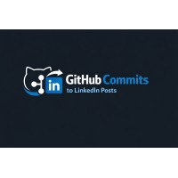

# Configuración de credenciales de LinkedIn

Los tokens de acceso de LinkedIn caducan aproximadamente cada 60 días. No hay
forma de evitarlo — LinkedIn retiró los tokens de larga duración — así que esta
es una tarea recurrente de dos minutos. Esta guía cubre cómo obtener un token la
primera vez y cómo renovarlo después.

## Una vez: crea la app

1. Ve a <https://www.linkedin.com/developers/apps> y haz clic en **Create app**.
   Ponle cualquier nombre, por ejemplo `github-linkedin-bot`, y elige un logo
   adecuado — aparece en la pantalla de consentimiento que ven los miembros
   cuando autorizan tu app:

   

2. Abre **Products** y solicita **ambos**. Necesitas los dos:

   | Producto | Por qué |
   | --- | --- |
   | **Sign In with LinkedIn using OpenID Connect** | Otorga los scopes `openid profile`, para que el script pueda leer tu nombre e ID. |
   | **Share on LinkedIn** | Otorga `w_member_social` — sin él, la autorización falla o la solicitud del post se rechaza con un 403. |

   Son aprobaciones separadas y debes esperar a que cada una esté **Approved**
   antes de autorizar. Omitir **Share on LinkedIn** es la causa más común de que
   falte `w_member_social` en el token.

3. Abre **Auth → Redirect URLs** y agrega estas dos:

   ```
   http://localhost:3000/callback
   http://127.0.0.1:4319/api/auth/linkedin/callback
   ```

   La primera es para `npm run auth:linkedin` (el script de CLI). La segunda es
   para el wizard de configuración (`npm run setup`), que ejecuta su propio
   servidor y tiene que ser el que reciba el callback. Si registras solo una, el
   método que no uses fallará con *This redirect URI has not been approved*.

   Si cambias el puerto del wizard, registra la nueva URL o configura
   `LINKEDIN_WIZARD_REDIRECT_URI` para que coincida. El servidor imprime la URL
   exacta que espera al iniciarse.

   Los valores deben coincidir exactamente, incluidos el esquema, el puerto y la
   ruta.

4. En la pestaña **Auth** de la app, copia el **Client ID** y el **Client secret**.

## Configura tu .env

```bash
LINKEDIN_CLIENT_ID=your_client_id
LINKEDIN_CLIENT_SECRET=your_client_secret
LINKEDIN_REDIRECT_URI=http://localhost:3000/callback
```

El client secret es una credencial real y **no** se envía a GitHub Secrets — el
job programado publica solo con el token de acceso, así que el wizard mantiene
deliberadamente ambas credenciales del cliente en local. Guárdalas solo en
`.env` (ignorado por git).

## Obtén tu token

```bash
npm run auth:linkedin
```

Esto abre tu navegador, apruebas la app y muestra:

```
LINKEDIN_ACCESS_TOKEN=...
LINKEDIN_AUTHOR_URN=urn:li:person:...
```

También puedes recibir una tercera línea:

```
LINKEDIN_REFRESH_TOKEN=...
```

**La mayoría de las apps no recibe una.** LinkedIn solo emite refresh tokens a
un conjunto limitado de apps asociadas aprobadas ("programmatic refresh
tokens"); todos los demás reciben un token de acceso con 60 días de vida y sin
forma de renovarlo programáticamente. No hay ningún scope que puedas solicitar
para desbloquear esto — LinkedIn rechaza el scope estándar de OpenID
`offline_access` por considerarlo desconocido. El script detecta esto y te lo
indica.

Copia las líneas que haya impreso. Agrégalas a `.env` para las ejecuciones
locales y como **GitHub repository secrets** (Settings → Secrets and variables →
Actions) para el job programado:

| Secret | Valor |
| --- | --- |
| `LINKEDIN_ACCESS_TOKEN` | el token de acceso |
| `LINKEDIN_AUTHOR_URN` | el author URN |

Solo agrega `LINKEDIN_REFRESH_TOKEN` si realmente lo recibiste.

## Comprueba que funcionó

```bash
npm run preflight
```

```
❌ Some credentials need attention:
  ✅ GitHub: authenticated as your-username
  ✅ LinkedIn: authenticated as Your Name
  ✅ Groq: model "<configured model>" is available and the key works
```

`✅ LinkedIn` significa que el token está activo. Si dice
`EXPIRED_ACCESS_TOKEN`, el token está muerto y necesitas uno nuevo.

## Renovación después de ~60 días

**Si te emitieron un refresh token** (raro — consulta arriba), no hace falta el
navegador:

```bash
npm run auth:linkedin -- --refresh
```

Eso genera un token de acceso nuevo e imprime los valores para actualizar.
Actualiza ambos secrets, ya que el refresh token también se reemplaza.

**Si no, que es lo normal**, vuelve a ejecutar el flujo completo:

```bash
npm run auth:linkedin
```

Es rápido: mientras sigas con la sesión iniciada en LinkedIn, se omite la
pantalla de consentimiento y solo redirige de vuelta con un código nuevo. Toma
el nuevo `LINKEDIN_ACCESS_TOKEN` y `LINKEDIN_AUTHOR_URN` y actualiza los secrets.

> Si cambias los scopes solicitados, LinkedIn invalida todos los tokens emitidos
> anteriormente — así que vuelve a ejecutar el flujo después de cualquier cambio
> de scopes y actualiza los secrets de inmediato.

## Solución de problemas

**`state mismatch`** — algo modificó la URL del callback. Vuelve a ejecutarlo.

**`Could not listen on port 3000`** — otra app está usando el puerto, o la
redirect URI de tu app de LinkedIn no coincide con `LINKEDIN_REDIRECT_URI`.
Deben ser idénticas y el puerto debe estar libre.

**`LinkedIn rejected the code`** — el código de autorización es de un solo uso y
caduca en unos 5 minutos. Vuelve a ejecutar el flujo; no reutilices un código
antiguo.

**`redirect_uri` mismatch error from LinkedIn** — la URI registrada en la app y
la de tu `.env` son diferentes. Compáralas carácter por carácter.

**`LinkedIn auth is not wired into the server yet.`** — el wizard se inició con
la autenticación deshabilitada explícitamente. Reinícialo normalmente con
`npm run setup`; si configuraste `LINKEDIN_CLIENT_ID` y
`LINKEDIN_CLIENT_SECRET`, se conecta solo.

**`Missing LINKEDIN_CLIENT_ID and LINKEDIN_CLIENT_SECRET`** — el botón
**Connect LinkedIn** del wizard necesita las credenciales de tu app, no un token
que ya tengas. Agrega ambas a `.env` y reinicia.

**`This redirect URI has not been approved`** — agrega la URI exacta en
Auth → Redirect URLs de la app de LinkedIn. Puede tardar unos minutos en
propagarse.

**403 al publicar** — al token le falta el scope `w_member_social`. Comprueba
que el producto **Share on LinkedIn** se haya solicitado y aparezca como
**Approved** en la pestaña Products de la app; luego vuelve a ejecutar
`npm run auth:linkedin` — un token antiguo no obtiene el scope de forma
retroactiva. Si el token también está vencido, `npm run preflight` lo informa
por separado.

**`unauthorized` o un error de scope al autorizar** — normalmente la misma
causa: **Share on LinkedIn** aún no está aprobado. Los productos solicitados
recientemente pueden tardar unos minutos en estar disponibles.
